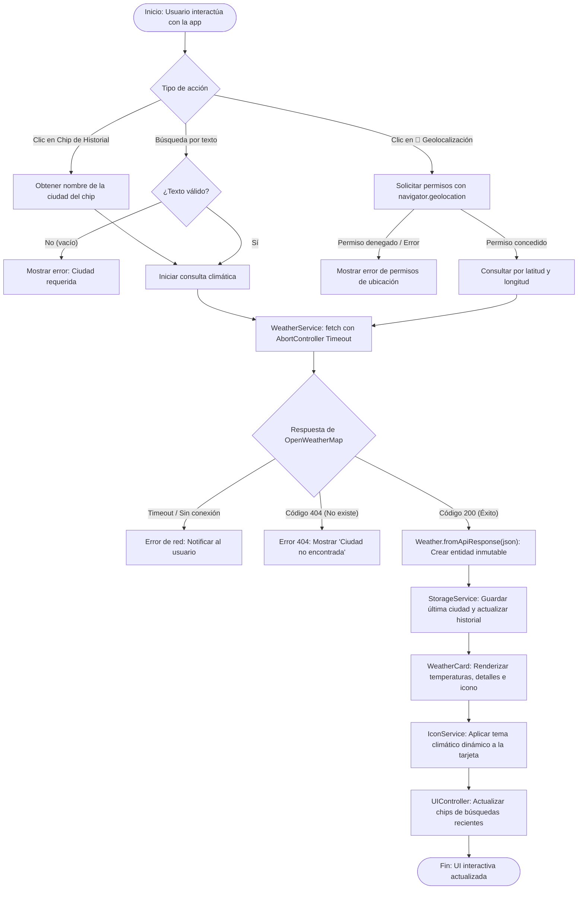
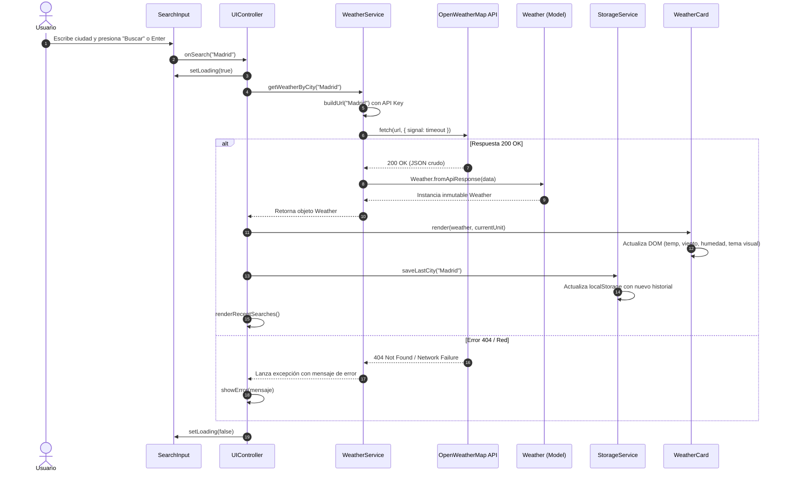

# 🌦️ WeatherPulse | Aplicación del Clima Dinámica


> Aplicación web dinámica del clima desarrollada con **Vanilla JavaScript moderno (ES Modules)**, arquitectura orientada a objetos (principios SOLID y patrones GRASP) y empaquetada con **Vite**.

---

## ✨ Características Principales

- 🔍 **Búsqueda global por ciudad:** Consulta en tiempo real con control de errores (404, caída de conexión, entradas vacías).
- 📍 **Geolocalización nativa:** Detecta automáticamente las coordenadas del usuario con `navigator.geolocation` y consulta el clima local.
- 📈 **Trayectoria Térmica 24 Horas (Canvas 2D Nativo):** Gráfica continua con curvas Bézier de neón cian, gradiente de relleno, temperaturas horarias y probabilidad de lluvia en tiempo real sin librerías externas.
- 🗓️ **Pronóstico Extendido a 5 Días:** Cuadrícula telemétrica con cálculo de rangos térmicos relativos (mínimas/máximas), barras de degradado y probabilidades de precipitación.
- 🌡️ **Conversor de unidades (°C / °F):** Alterna al instante entre Celsius y Fahrenheit reactivamente en toda la pantalla (tarjeta actual, gráfica y pronóstico a 5 días).
- 🕒 **Historial persistente & Chips interactivos:** Guarda las últimas ciudades consultadas en `localStorage` con opción de acceso rápido y eliminación individual.
- 🎨 **Ambientación climática HUD:** La estación y su resplandor adaptan sus tonalidades y atmósfera según el clima (despejado, lluvia, nieve, nublado, tormenta).
- ⌨️ **Atajos de teclado:**
  - Presiona `/` desde cualquier lugar para enfocar la barra de búsqueda inmediatamente.
  - Presiona `Escape` para limpiar el campo de búsqueda.
- 🛡️ **Resiliencia ante fallos:** Manejo de cuota de almacenamiento, timeout de conexión configurable y fallback en memoria.

---

## 🏗️ Arquitectura y Patrones de Diseño

El proyecto no utiliza frameworks pesados con el fin de demostrar un dominio profundo de las **Web APIs nativas**, manipulación eficiente del DOM y patrones arquitectónicos:

```text
proyecto-clima/
├── js/
│   ├── models/
│   │   ├── Weather.js         # Entidad inmutable del clima actual y validación
│   │   └── Forecast.js        # Entidad de pronóstico (puntos horarios y diarios)
│   ├── services/
│   │   ├── WeatherService.js  # Peticiones HTTP paralelas, timeouts y endpoints
│   │   ├── StorageService.js  # Abstracción de persistencia con fallback
│   │   └── IconService.js     # Resolución de assets, temas y accesibilidad
│   ├── ui/
│   │   ├── SearchInput.js     # Componente del formulario y atajos de teclado
│   │   ├── WeatherCard.js     # Renderizado y telemetría de la tarjeta principal
│   │   ├── ThermalChart.js    # Motor gráfico de curva térmica en Canvas 2D
│   │   ├── ForecastView.js    # Cuadrícula telemétrica de predicción a 5 días
│   │   └── UIController.js    # Controlador mediador (GRASP Controller)
│   ├── app.js                 # Composición de dependencias (DIP)
│   ├── config.js              # Configuración y constantes centralizadas
│   └── main.js                # Punto de entrada de la aplicación
├── styles.css                 # Sistema de diseño futurista HUD con CSS Variables
├── index.html                 # Estructura semántica HTML5 con layout táctico
├── package.json               # Dependencias y scripts de desarrollo (Vite)
└── vite.config.js             # Configuración del empaquetador
```

### Principios aplicados

- **Single Responsibility Principle (SRP):** Cada clase tiene una única razón de cambio (`SearchInput` solo atiende el input, `WeatherCard` solo renderiza, `StorageService` solo persiste).
- **Dependency Inversion Principle (DIP):** Inyección de dependencias en `UIController` y `WeatherApp` para facilitar el testing y desacoplar componentes.
- **Inmutabilidad:** La entidad `Weather` sella sus propiedades con `Object.freeze()` evitando mutaciones accidentales en tiempo de ejecución.

---

## 🔄 Diagramas del Sistema

### 1. Diagrama de Flujo (Ciclo de Vida de una Búsqueda)



### 2. Diagrama de Secuencia (Interacción entre Capas y Servicios)



---

## 🚀 Instalación y Puesta en Marcha

### Prerrequisitos

- [Node.js](https://nodejs.org/) (versión 18 o superior)
- Clave de API gratuita de [OpenWeatherMap](https://openweathermap.org/api)

### 1. Clonar el repositorio

```bash
git clone https://github.com/tu-usuario/proyecto-clima.git
cd proyecto-clima
```

### 2. Instalar dependencias

```bash
npm install
```

### 3. Configurar variables de entorno

Crea un archivo `.env` en la raíz del proyecto (puedes guiarte con `.env.example`):

```env
VITE_API_KEY=tu_api_key_de_openweathermap
```

### 4. Iniciar en modo desarrollo

```bash
npm run dev
```

### 5. Compilar para producción

```bash
npm run build
npm run preview
```

---

## 🛠️ Tecnologías

- **Lenguaje:** JavaScript ES6+ (Modules, Classes, Async/Await, AbortController, Geolocation API).
- **Tooling:** [Vite](https://vitejs.dev/) para HMR ultrarrápido y bundling de producción.
- **Estilos:** CSS3 moderno (Flexbox, CSS Grid, Custom Properties, Glassmorphism, animaciones `@keyframes`).
- **Persistencia:** Web Storage API (`localStorage`) con fallback en memoria.

---

## 📄 Licencia

Distribuido bajo la Licencia MIT.
